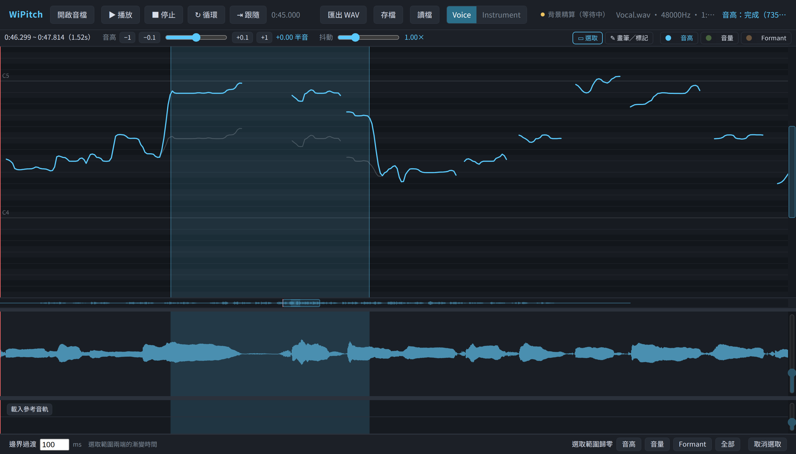

# WiPitch

**在瀏覽器裡修人聲音準的免費工具**——類似 Melodyne（單音模式）或 Logic 的 Flex Pitch。

把一段人聲乾聲拖進來，WiPitch 會畫出它的音高曲線和波形。你可以：

- 圈選一段，上下拖曳就改音高
- 把抖音壓平，或反過來把抖動放大
- 調整一段的音量、音色（Formant）
- 用畫筆直接畫出想要的音高線，還能自動加上自然的抖音
- 用錨點把某一段拉長或縮短（time stretch）
- 載入伴奏一起聽，確認有沒有對準

每個動作完成後會自動重新算繪，馬上就能播來聽。原始音檔永遠不會被修改，
隨時可以復原，改再多次音質也不會劣化。

所有處理都在你的電腦上完成，**音檔不會上傳到任何地方**。

**線上試用：<https://nicechord.com/wipitch/>**（不用安裝，打開就能用）



## 安裝

### 離線安裝包（推薦）

只需要 [Node.js](https://nodejs.org/) 18 以上，Linux 與 macOS 都可以。不需要網路。

```
tar xzf wipitch-<版本>.tar.gz
cd wipitch-<版本> && ./install.sh
wipitch
```

執行 `wipitch` 會自動用瀏覽器打開 `http://127.0.0.1:5180/`。

### 從原始碼執行

Windows 與 macOS 開發請使用 Node **22.23.2**（見 `.nvmrc`）。換作業系統後重新執行 `npm ci`，不要沿用另一平台的 `node_modules`。Windows 可雙擊 `start-wipitch.cmd`，或使用 `npm run dev:local`。

四平台的執行方式、行動裝置限制及驗收清單見 [跨平台開發說明](docs/CROSS_PLATFORM.md)。


```
git clone https://code.wiwi.blog/wiwi/WiPitch.git
cd WiPitch
npm ci
npm run dev
```

然後用瀏覽器打開 `http://localhost:5180/`。

> 開發伺服器預設綁在 `0.0.0.0`，同一個區網的其他電腦也連得到。
> 只想自己用的話，把 `package.json` 裡 `dev` 指令的 `--host 0.0.0.0` 拿掉。

### 放到自己的網頁主機

WiPitch 的所有運算都在使用者的瀏覽器裡進行，伺服器只負責送出靜態檔案，不需要後端，也不耗伺服器 CPU。

```
npm ci
npm run build
```

把 `dist/` 裡的內容上傳到任何靜態網頁主機即可（nginx、Apache、Caddy 等），放在根目錄或子目錄（例如 `/wipitch/`）都可以。

- 整包約 15MB，大部分是音高偵測引擎的 WebAssembly；建議開啟 gzip／brotli 壓縮。
- `.wasm` 檔要以 `application/wasm` 送出（主流主機預設即是如此）。
- 不需要設定 COOP／COEP 等特殊標頭。

## 快速上手

1. 把音檔拖進視窗（或按「開啟音檔」）。第一次會花幾秒偵測音高。
2. 在上方的曲線區**左右拖曳**，選一段要修的地方。
3. 在選取範圍裡**上下拖曳**，音高就跟著移動。放開後自動算繪。
4. 按空白鍵播放來聽。不滿意就 `Ctrl/Cmd+Z` 復原。
5. 修好了按「匯出 WAV」。

## 畫面說明

由上到下：

| 區域 | 用途 |
|---|---|
| 頂端列 | 開檔、播放／停止／循環／跟隨、匯出、存檔／讀檔、人聲／樂器模式、最右邊的「?」連到這份說明 |
| 工具列 | 左邊顯示目前能調的參數；右邊是工具（選取、畫筆╱標記）與 lane 切換 |
| 曲線區 | 音高、音量、Formant 三條曲線，編輯都在這裡 |
| 橫向範圍捲軸 | 整首的總覽，也是捲動與縮放的控制 |
| 波形軌 | 主唱的波形；錨點也在這裡加 |
| 參考音軌 | 伴奏或導唱，只用來監聽 |
| 底部列 | 邊界過渡、音高變化上限、選取範圍歸零、取消選取 |

### 三條曲線（lane）

曲線區可以同時顯示三條線，其中一條是「正在編輯」的對象，按 `1` `2` `3` 切換：

| 鍵 | lane | 單位 | 意義 |
|---|---|---|---|
| `1` | 音高 | 半音 | 相對於原本唱的音高偏移多少 |
| `2` | 音量 | dB | 音量增減 |
| `3` | Formant | 半音 | 音色（聲道共鳴）的偏移，跟移調多少無關 |

`Shift` + `1`/`2`/`3` 可以單獨顯示或隱藏某條線。

## 操作

### 選取工具（`S`）

| 操作 | 動作 |
|---|---|
| 在曲線區或波形軌左右拖曳 | 選取一段 |
| 點一下（選取範圍內外都可以） | 移動播放頭，**選取會保留** |
| 在選取範圍內上下拖曳 | 改變目前 lane 的值 |
| 在選取範圍內 `Shift` + 上下拖曳 | 調整抖動：往下壓平、往上放大 |
| `Ctrl/Cmd` + `A` | 選取整個檔案 |
| `Esc` | 取消選取 |

有選取時，工具列左邊會出現目前 lane 的滑桿：

- **音高**：±1、±0.1 半音微調鈕與滑桿；另有「**抖動**」滑桿——0 = 完全壓平，1 = 原樣，大於 1 = 放大。刻意的滑音會保留。
- **音量**、**Formant**：各自的滑桿。

滑桿在選取期間可以任意來回調，拉回中性值就完全回到原樣，不會越調越歪。

### 畫筆╱標記工具（`B`）

**在曲線區：畫線。** 直接畫出目前 lane 的形狀，音高畫的是絕對音高。

| 操作 | 動作 |
|---|---|
| 拖曳 | 自由畫 |
| 拖曳時按住 `Shift` | 畫直線（從落筆點拉到游標） |
| 拖曳時按住 `Alt`/`Option` | 吸附到整數半音 |

工具列左邊會出現畫筆選項：

- **抖音**（`V`）：畫出來的線自動加上抖音，可以設幅度與速度。
- **漸入**（`Shift+V`）：抖音從落筆處慢慢長出來，而不是一開始就滿幅度——真人的抖音就是這樣。

**在波形軌：加錨點。** 點一下就在那個位置加入一個錨點（黃色三角形）。

切到畫筆時選取範圍會保留，切回選取工具就能繼續調同一段。

### 錨點與 time stretch

兩個錨點之間的段落會跟著錨點線性伸縮。例如在 1 秒和 2 秒各加一個錨點，
把 2 秒那個拖到 3 秒，原本 1~2 秒的內容就被拉長一倍，後面整段往後移。

- 錨點在任何工具下都可以拖曳（滑鼠移到把手上會變成左右箭頭）。
- 點一下 = 選取；`Shift` + 點擊選取一個範圍內的所有錨點；`Ctrl/Cmd` + 點擊加入或移出單一個。選到的會一起拖。
- `Delete`／`Backspace` 刪除選取的錨點，那段伸縮就恢復原狀。
- 最後一個錨點可以拖過檔尾；拖到畫面邊緣會自動捲動。
- 伸縮時三條曲線跟著聲音一起走；刪錨點只恢復時間，畫過的數值不會被清掉。

伸縮過的段落在背景會再精算一次，消除接縫處的細微相位感（頂端列的黃色指示燈顯示進度）。
期間可以照常播放與編輯；匯出 WAV 會等它算完。

### 邊界過渡

底部列的「邊界過渡」（預設 100ms）決定用選取工具編輯時，選取範圍兩端用多長的時間漸變過去。
太短聽起來會「跳」一下；太長會影響到範圍外面。三條 lane 共用。

畫筆固定使用很短的 20ms 過渡，才能精確畫出想要的形狀。

### 音高變化上限

底部列的「音高變化上限」（預設每秒 60 半音）限制**相對原唱的音高偏移**變化得多快。

原唱本身有很陡的音高變化（例如換音），而你把它修成平的，偏移量在那裡就會變成一個陡的階梯，
聽起來像「抽」一下。這個上限會自動把階梯拉緩成很短的斜坡：1 個半音約 33ms，一般聽不出是滑音。
抖音、刻意的滑音不受影響。設成 0 = 不限制。

它只影響之後的編輯，不會回頭改已經做好的地方，並且會存進專案檔。
按住 `Alt`/`Option` 吸附整數半音時，偵測音高跳動處的那幾格會被拉緩，不一定剛好落在整數上；需要的話先設成 0。

「選取範圍歸零」可以分別清掉這段的音高、音量、Formant 編輯，或全部清掉（錨點不受影響）。

### 參考音軌

在參考音軌按「載入參考音軌」，可以載入一個一起播放的伴奏或導唱，修音時才聽得出有沒有對準。
任何格式、長度或取樣率都可以。

- 音量滑桿（雙擊回 0 dB）、靜音（`M`）、offset 微調（±10ms，正數 = 參考音軌晚開始）。
- 參考音軌**不會跟著錨點伸縮**，也**不會被匯出**。
- 存檔會記住它的檔名與設定（不含音訊）；讀檔後再載入同名檔，設定會自動套用。

### 人聲／樂器模式

頂端列的切換，決定**移調時音色要不要跟著跑**：

- **人聲**（預設）：保留音色。拉高好幾個半音仍然是同一個人在唱。
- **樂器**：音色完全跟著移調，類似變速的效果。

這是整個檔案的設定。想要介於兩者之間，就用 Formant 那條 lane 分段調。

## 視野

| 操作 | 動作 |
|---|---|
| 橫向範圍捲軸 | 拖中間捲動、拖左右兩端縮放、點空白處跳過去、**雙擊看全部** |
| 曲線區右側的縱向範圍捲軸 | 目前 lane 的上下捲動與縮放，**雙擊還原** |
| 滾輪 | 上下捲動（在波形軌上是左右捲動） |
| `Shift` + 滾輪 | 左右捲動 |
| `Ctrl/Cmd` + 滾輪 | 上下縮放 |
| `Ctrl/Cmd` + `Shift` + 滾輪 | 左右縮放 |
| `F` | 畫面跟隨播放頭 |
| 拖軌道之間的分隔線 | 調整波形軌、參考音軌的高度，**雙擊還原** |
| 波形軌右側滑桿／`Alt` + 滾輪 | 放大波形顯示（素材太小聲時用，不影響聲音），**雙擊還原** |

## 快速鍵

| 鍵 | 動作 |
|---|---|
| 空白鍵 | 播放／暫停 |
| `S` / `B` | 選取工具／畫筆╱標記工具 |
| `1` / `2` / `3` | 編輯音高／音量／Formant |
| `Shift` + `1`/`2`/`3` | 顯示或隱藏該條線 |
| `L` | 循環播放選取範圍 |
| `F` | 畫面跟隨播放頭 |
| `M` | 參考音軌靜音 |
| `V` / `Shift` + `V` | 畫筆抖音／抖音漸入開關 |
| `Ctrl/Cmd` + `A` | 全選 |
| `Esc` | 取消選取 |
| `Delete` / `Backspace` | 刪除選取的錨點 |
| `Ctrl/Cmd` + `Z` | 復原 |
| `Ctrl/Cmd` + `Shift` + `Z` | 重做 |

## 存檔與匯出

- **存檔**：產生 `.wipitch.json`，只含曲線、錨點與設定，不含音訊，檔案很小。讀檔時要先開啟同一個音檔。
- **匯出 WAV**：輸出 24-bit 的成品。

## 技術

- 音高偵測：[SwiftF0](https://github.com/lars76/swift-f0)（ONNX，在瀏覽器的 Web Worker 裡跑）
- 變調與時間伸縮：[Rubber Band Library](https://breakfastquay.com/rubberband/) 3.3（WebAssembly）
- 介面：TypeScript + Canvas，沒有使用前端框架
- 琴鍵試聽：[Tone.js Sampler](https://tonejs.github.io/examples/sampler) 搭配 Salamander 鋼琴取樣，透過電腦喇叭播放。滑鼠進入琴鍵區或鍵盤聚焦時預載音色；按住發聲、放開後短暫衰減。音色約 2 MB，隨程式保存，不需連線到外部音色服務。

設計細節、實測數據與開發說明見 [`docs/DESIGN.md`](docs/DESIGN.md) 與 [`docs/DEVELOPMENT.md`](docs/DEVELOPMENT.md)。

## 授權

GPL-3.0。Rubber Band Library 以 GPL 授權，本專案隨之。

Tone.js 使用 MIT 授權。鋼琴取樣由 Alexander Holm 製作（Salamander Grand Piano / Yamaha C5），採 [CC BY 3.0](https://creativecommons.org/licenses/by/3.0/) 授權。取自 [Tone.js 官方音色庫](https://github.com/Tonejs/audio/tree/master/salamander)，30 個 MP3 檔保持原樣，原始作者說明保存在 `public/audio/salamander/README`。
